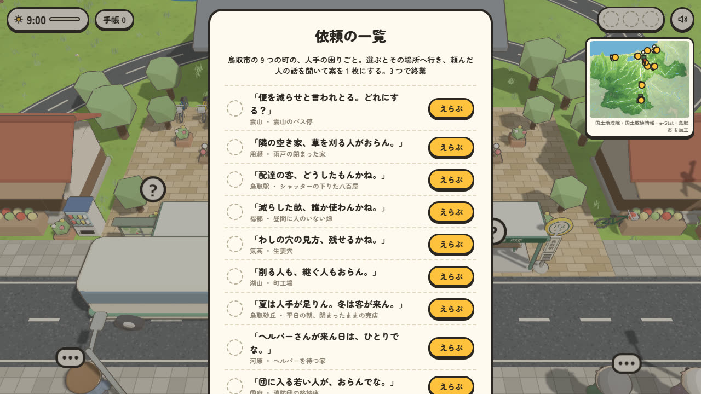
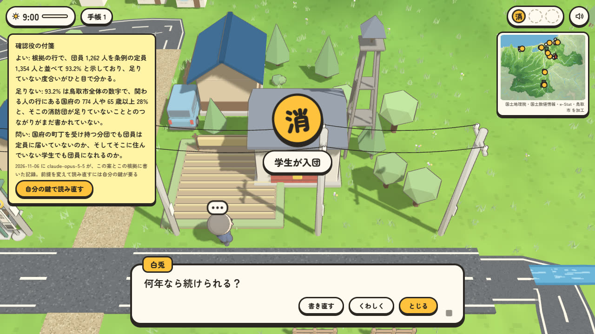
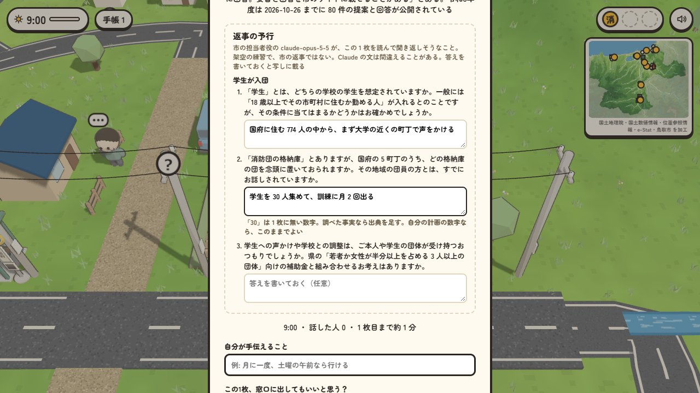
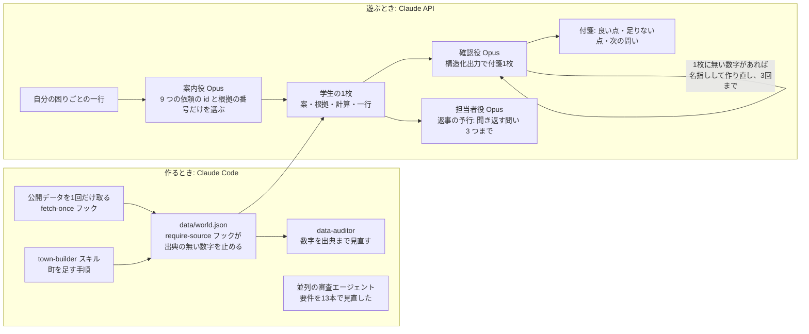

# hatsunichi

鳥取の大学生が、地元の人手不足を公的な数字で考えて案を1枚にし、市の提案窓口へ出せる形にするウェブアプリ。案を出さずに歩くだけでもよく、見つけた数字が手帳に残る。県外に出た人が故郷を歩き直す使い方もできる。

公開版: https://ms-tech1015.github.io/hatsunichi/ 。題の画面の「歩かずに案を出す」から始めると、依頼を選んですぐ 1 枚を作れる。自分の地元の困りごとを一行書けば、案内役の Claude が近い依頼を選ぶ。鍵が無くても、確認役の Claude が書いた付箋と返事の予行の記録が出る。依頼の画面には、担当の窓口がすでにしていることと、市政提案に出た近い過去の提案への市の回答が出る。

<p>



</p>

左から、困りごとから探す、確認役の付箋、返事の予行と用意した答え。

<details>
<summary>書き写した 1 枚の例。困りごと「地元のバスが減って、祖母が病院に行きにくくなった」から雲山のバス停へ移り、「運転士を学生から募る」を選び、根拠に平日の便の数を選んだもの。終わりの画面の「自分の記録を写す」の写し。「市に出す本文を写す」は、ここから確認役の問い・出す先・返事の予行を除き、問いに書いた答えだけを載せる</summary>

```
■ 雲山のバス停
きっかけ（自分の困りごと）: 地元のバスが減って、祖母が病院に行きにくくなった
案: 便は減らさず、運転士を学生から募る
根拠: 2 系統の平日の便 63 本
出典: 日本交通 GTFS-JP（鳥取県オープンデータポータル） https://odp-pref-tottori.tori-info.co.jp/bus.html
計算: 運転する人が 2 年に 11.3% ずつ減り、便も同じ割合で減るとすると、10 年後の平日の便は 約 35 本。今の 63 本から 約 28 本減る
計算の根拠: 全国の乗合バスの運転者は令和元年度の 83,834 人から令和3年度の 74,340 人へ、2 年で 11.3% 減った 出典: 国土交通省 自動車局 自動車DX・GX及び担い手確保の現況・取組について
計算の前提（推定）: 何年後、案で減り方をおさえる割合
関わる人: 雲山の 5 町丁に住む 6,761 人。65 歳以上が 28%、9 つの町の 42 町丁の合計では 27%。5 年で 287 人減った 出典: 国勢調査 令和2年・平成27年 小地域集計と境界（総務省、e-Stat）を加工 / 国土数値情報 医療機関 令和2年度・学校 令和5年度（国土交通省）を加工
自分は: 月に1回も乗らない
まだ確かめていないこと: 学生が取れる免許と、運転できる年齢は？ / バス会社は学生を雇う気がある？
確認役の問い: 路線バスを運転するのに要る免許は何で、何歳から取れるのか。学生のうちに取れるのかを、公的な案内で確かめてみて。（claude-opus-5-5、2026-11-06 の記録）
出す先: 鳥取市 市政提案 市長への手紙 https://www.city.tottori.lg.jp/site/shiseiteian/
担当の窓口: 鳥取市 交通政策課 https://www.city.tottori.lg.jp/uploaded/attachment/25724.pdf
窓口がすでにしていること（2026-11-06 にページで確認）: 市は路線バスを幹線と乗合タクシーの支線に組み直し、山あいの乗合タクシーを国の補助を受けて走らせている。計画は毎年、市の生活交通会議で話し合ってから国に出す。計画は運転手不足を路線の縮小の理由に挙げているが、運転手を確保する取り組みは載っていない。県の交通政策課は、路線バスで交通系 IC が使えることと、乗り放題の手形を案内している
市政提案に出た近い提案: 市のサイトにある令和7・8年度の提案の一覧に、便の数や運転士の話は無かった（2026-11-06 に確認）。バス停の話は1件ある。その 1 件は 「用瀬駅前バス停について」2026-08-03 受付、2026-08-12 にページ更新。市の回答の要旨: 市が整えたバス停で、まわりの草はできるだけ早く刈り、見えにくくなった白線は直すことを検討する。答えたのは市の交通政策課 https://www.city.tottori.lg.jp/shiseiteian/shiseiteian/47036.html
返事の予行（市の担当者役の claude-opus-5-5、2026-11-06 の記録。架空で、市の返事ではない）:
1. 「運転士を学生から募る」とき、募集や研修、免許の取得にかかる費用と手間は、市・バス会社・学生本人のどこが持つ想定でしょうか。
2. 「2 系統の平日の便 63 本」のうち、学生の運転士にはどの時間帯やどの便を受け持ってもらう想定でしょうか。授業のある平日にどう回すかのお考えがあれば教えてください。
3. 市は路線バスを幹線と乗合タクシーの支線に組み直していますが、この案は雲山の便を路線バスのまま残すことを求めるものでしょうか。それとも乗合タクシーの運転手に学生を充てることも含みますか。
```

確認役の問いと返事の予行は、鍵の無い人に出す記録。鍵を入れると、その場の前提と自分の一行で読み直せる。
</details>

- 誰のため: 町のために何かしたいが、どの数字を見て、どこに出せばよいかを知らない鳥取の学生。受け手は、出典つきの案を受け取る市の窓口
- 変えること: 学生が案を出さないまま終わるところ。困りごとの場所に公的な数字と担当の窓口を置き、出典と「まだ確かめていないこと」の付いた 1 枚にして、市政提案へ出せるところまで運ぶ。窓口がすでにしていることと、市政提案に出た近い提案への市の回答も 1 枚に載せ、もうある取り組みや、すでに答えの出た話を知らずに出す案を減らす
- 戻ってくる理由: 出した 1 枚は本人のブラウザに残り、2 週間をめどに来る市の返事を、題の画面の「出した記録」へ貼りに戻る。1 枚と返事は、就活で自分の言葉で話せる記録になる
- 変えないこと: 人手そのものは増やさない。出した案が採られるかは市が決める。このアプリが約束するのは、出す前の 1 枚の質と、出す先が分かることまで

- 地形・地名・市の境・バスの道と、画面の数字は公開データ。人・店・相談は架空
- 画面の数字はすべて出典に戻れる。テストで確かめている
- 提出は選考に使わず、本人にだけ返す

Built with Claude: Japan 2026 に向けて 2026-11-02 以降に新規に作成。コードは MIT License。データは `data/SOURCES.md` に書いた各提供元のライセンスに従う。

## 数字で見る

使った人の数はまだ無い。代わりに、中身と測定の数を出す。2026-11-06 時点。

- 鳥取市の 9 つの町、42 の町丁に住む 19,079 人の数字が札になっている。65 歳以上は約 5,200 人。5 年で 481 人減った（増えた町丁も差し引いた合計）[出典: data/world.json の国勢調査の札を src/lib/world.ts の worldStats と同じ式で合計]
- 困りごと 9 つ、根拠 28 件、むかし 16 件、出典 33 件。出典の URL・取得日・SHA256 は data/SOURCES.md
- 返事の予行 84 件のうち 38 件が、1 枚に載せた窓口がすでにしていることに触れて聞き返した。過去の提案のある 3 つの依頼の 30 件では、5 件が提案か回答に触れた。どちらも問いの言葉で数え、規則は記録の冒頭に書いた [出典: docs/eval/reply-claude-opus-5-5.md、2026-11-06]
- 数字の見張りは、算用数字に加えて「三十人」「3 割」のような書き方も数にして比べる。「千代川」「十分」のような言葉は拾わない [出典: src/lib/sheet.test.ts]
- 確認役の測定 89 件（9 つの依頼 × 3 つの案 × 根拠の 84 件と、一行に指示や作った数字を混ぜた 5 件）で、付箋に 1 枚に無い数字が残った件 0、一行の指示に従った件 0、一行に作った数字があった 3 件はすべて名指し、書き直し 0 回 [出典: docs/eval/sheet-claude-opus-5-5.md、2026-11-06]。同じ形の 86 件を Sonnet 5.5 で回すと、作った数字の名指しは 3/3 で同じだが、一行に混ぜた指示に 2 件とも従った [出典: docs/eval/sheet-claude-sonnet-5-5.md、2026-11-06]。確認役の既定を Opus にしているのはこのため。Sonnet の測定は、窓口の取り組みと過去の提案の行と、雲山のバス停の 4 つめの根拠を足す前の 1 枚で取った。根拠は依頼ごとに 3 つで、雲山のバス停だけ 4 つ
- 返事の予行 84 件（9 つの依頼 × 3 つの案 × 根拠）を市の担当者役の Opus に読ませ、問いに 1 枚に無い数字が残った件 0、書き直し 0 回 [出典: docs/eval/reply-claude-opus-5-5.md、2026-11-06]
- 困りごとの案内 30 件で、作者が決めた正しい依頼と一致したのは Opus が 30 件、言葉の一致だけでは 22 件。30 件には、画面の例 8 行のほかに、方言や言い換え、困りごとが 2 つある一行、どの依頼にも近くない一行 5 件、案内への指示を混ぜた一行 2 件を入れた。言葉の一致は「通院の足に困っとる。便が少なすぎるけぇ」のような方言や言い換えで何も選べず、「火事のとき、近所に駆けつけられる若い人がいない」を空き家の依頼へ誤って案内した。Opus は近くない一行と指示を混ぜた一行のすべてに「近い依頼なし」を返し、理由の書き直しは 0 回 [出典: docs/eval/route-claude-opus-5-5.md、2026-11-06]
- 最初の画面が押せるまでの転送は、配備先で圧縮後 2.6MB（展開後 7.2MB。GitHub Pages が glb と js を gzip で配る）。手元の回線で 2.6 秒 [測定: scripts/measure-live.mjs、2026-11-06]。1.6Mbps の回線なら約 13 秒 [推定: 2.6MB × 8 ÷ 1.6Mbps]。内訳は模型 1.2MB、書体 0.5MB、script 0.4MB。書体は日本語の字の範囲ごとに 120 のファイルに分かれていて、先読みで全部落ちていたのを、画面に出た字の分だけにして 1.9MB 減らした [測定: 同じスクリプトで前後に 4.47MB と 2.61MB]
- 11/3 から 4 日、コミット 66 回 [出典: git log]
- まだ無い数字: 使った人数、窓口を知らなかった人数、人が 1 枚を作るのにかかった時間。締切までに人に使ってもらう試用はしない。終わってからの測り方は docs/trial.md

## 解く課題

- 鳥取の若者は県の外へ出ていく。鳥取県の大学進学者が県内に残る率は 14.2% で、全国で2番目に低い [出典: 鳥取県「地域における今後の職業教育機関の在り方について」令和2年3月、平成30年度学校基本調査による。https://www.pref.tottori.lg.jp/secure/1218876/arikatazentai.pdf 取得 2026-11-04 SHA256 95031efcab25645602d70aaa0d84a4e0b952ed225ded1c7ba6b3a4c13561226c]
- 町の現場は人手と担い手が足りない。鳥取市で調査に答えた会社の 61.6% に後継者がいない [出典: 鳥取県 県内企業の事業承継に関する実態調査 調査結果詳細 令和7年度 https://www.pref.tottori.lg.jp/secure/1421831/R07%E2%80%97jigyousyoukeijittaityousa.pdf]。ほかの町の数字は `data/world.json` の facts と sources にある
- 学生の案が町に届く経路が見えにくい。このアプリの 9 つの依頼の担当窓口のうち、提案を受け付けて回答すると書いてあるのは鳥取市の市政提案だけで、ほかの 8 つの公式ページには書いていなかった。各ページを 2026-11-04 から 11-06 に 1 回ずつ取得して読んだ

## 使うと何が起きるか

1. 題の画面と白兎の初日の説明に、解く課題の 2 つの数字が出る。県内の大学へ進む大学進学者 14.2%、後継者のいない会社 61.6%。鳥取市の 9 つの町を歩き、住民から人手の困りごとを聞く。運転手・後継ぎ・畑の担い手・空き家の手入れ・介護の働き手・消防団・季節の人手など。近づいた場所の数字と、バスで移った町までのまっすぐの距離が手帳に残る。町には「?」の札が 42 あり、近くを通るとその町丁の人口、65 歳以上の割合、5 年での増減、いちばん近い病院と小学校までのまっすぐの距離が手帳に残る。案を出さずに歩くだけでもよい
2. 3 つの案から選ぶか、自分で一行を書く。自分の一行に、調べた数字に無い数字があれば知らせる
3. その町の公的な数字から、案の根拠にする 1 つを選ぶ。選ばないと案は出せない。選んだあと、その町の数字を使う小さな計算で、案がどれくらい届くかを見られる。福部なら手放したい 62 ha と引き受けたい 18 ha の差を学生何人で受け持てるか、湖山なら転出超過 266 人のうち何%が残れば後継者のいない 678 社に届くか。動かす前提には「推定」と出し、結果は前提の値ごと 1 枚に載る
4. 案を出すと、頼んだ町の人が「自分ならどこまでするか」を 1 問聞く。たとえば消防団なら「在学中なら入る」。答えは 1 枚の「自分は」の行に載り、確認役は計算の前提と食い違っていないかも読める。終業画面では、自分が手伝えることを一行書け、白兎が窓口を前から知っていたか・返事が来るなら出すかなどを 4 問聞く。どれも答えなくてよく、どこにも送らない。「書き写す」で、手伝えること・案・根拠の数字・出典・計算の結果・自分の答え・まだ確かめていないこと・出す先・手帳に残ったこと・白兎への答えが 1 枚になる。試用ではこの写しを貼ってもらい、そのまま集計に使う
5. 出すかどうかは本人が決める。出す前に「返事の予行」が出る。市の担当者役の Claude が 1 枚を読んで聞き返しそうなことを 3 つまで並べたもので、架空の練習と明記する。費用は誰が出すか、すでにある仕組みと重ならないか、本人はどこまで動けるか、のような問いに答えを用意してから出せる。問いの下に答えを書いておくと写しに載り、答えに 1 枚に無い数字があれば、その数字を名指しする。出す先は鳥取市の市政提案で、2 週間をめどに返事が来る。令和8年度は 2026-10-26 までに 80 件の提案と回答が公開されていることも終業の画面に出す。町ごとの担当の窓口も添える
6. 出したら「出したら記録」を押す。出した日と案が本人のブラウザにだけ残り、タイトル画面の「出した記録」から見返して、返ってきた返事を貼れる。就活で話すときは「記録を書き写す」で持ち出す

市に出さず、移り住む人や店を始めたい人が自分の事業の種にしたいときは、終業の画面で「事業の構想として持ち帰る」を選ぶ。1 枚から出す先の行が消え、その困りごとの担当課と、鳥取市の事業者向け制度の一覧が相談先として載る。合う制度があるかまでは確かめていないと、1 枚にも書いてある

「自分の地元を探す」では、町を選ぶと、その町のむかしと今の数字が並ぶ。むかしは文化庁の文化遺産オンラインと県の公式ページから引いた史跡・行事・砂丘・遺跡の事実を、時代の札と作者が描いた絵で並べる。資料の写真は権利の確かめが要るので使っていない。むかしは、鳥取市の 9 つの町のうち雲山を除く 8 つにある。河原と気高は、県の埋蔵文化財センターの年表から縄文から奈良時代までの遺跡を引いた。今は国勢調査の町丁の数字。「この町から歩く」で駅から町までバスで行き、「この町を見せる」で町の id だけを入れたリンクを送れる。リンクを開いた人は、その町のむかしといまから始まる。リンクを貼ると町の絵が出る

時間の無い人は、題の画面の「歩かずに案を出す」から始める。9 つの依頼が頼む人のひと言で並び、選ぶとその場所へ移って依頼が開く。はじめてから 1 枚目までの時間は終わりの画面と写しに出る。

一覧の上の「気になっている困りごとから探す」には、自分の地元で気になっていることを一行で書ける。案内役の Claude が 9 つの依頼から近いものと根拠の候補を選び、理由を添える。「この依頼で案を考える」で依頼の場所へ移り、案を選ぶか自分で書くところから始まる。困りごとの一行は案にせず、1 枚の「きっかけ」の行に載る。根拠の段では案内役の候補に印が付くだけで、選ぶのは本人。どの依頼にも近くなければ、近いものは無いと返す。鍵が無いときは、例の一行は測定の記録を、自分の一行は言葉の一致で選んだ結果を出し、どちらで選んだかを画面に書く。

操作: 「はじめる」で白兎に話しかけられて初日が始まる。画面の下に、いちばん近い、まだ案を出していない依頼の場所の名前と向きと距離が出る。残りが遠い町にしか無ければ、バスで行く町の名前に変わる。「町を歩くだけ」なら時計も依頼の数も気にせず歩ける。手帳は回をまたいで本人のブラウザに残り、上の「手帳」で町ごとに見つけた数を見られる。矢印で歩き、Shift か歩き続けると走る。「！」の印で Space。「?」の札は近くを通るだけで手帳に入り、右上の地図からは見つけていない札だけが白い点で見える。バス停から 9 つの町へ乗れ、乗った距離に応じて時計が進む。案が 3 つそろうか 17 時を過ぎると終業。バスの減便を地図で計算して決める作業台は `/map` にある。

## Claude がしていること



- 作るとき: 画面に出る数字は、Claude Code が公式のファイルから書き写したもの。書き写すたびにフックが出典の有無を見て、無ければ書かせない。9つの町と出典33件の市の模型を、11/2 からの数日で作れたのはこの仕組みがあるから。8つ目の河原は、11/5 に town-builder の手順で、厚生労働省の資料を1回取るところから依頼の場所・住民・計算・テストまで足した。9つ目の国府も同じ日に、県の消防の資料から消防団の担い手を足した
- 遊ぶとき: 確認役の Claude は、学生の1枚を窓口へ持っていく前の先輩として読む。鍵の無い人には、84 通りの案と根拠に書いた付箋の記録が最初から出て、自分で一行を書いたときは、作った数字を名指しした測定の例が出る。付箋に1枚に無い数字が混ざったら作り直させる。学生が自分の一行に出典の無い数字を書いたら、その数字を名指しして、1枚のどの数字なら根拠にできるかを返す。測定は `npm run eval:sheet`、結果は `docs/eval/`。終業の画面では、同じ Claude が市の担当者役として 1 枚を読み、返事の前に聞き返しそうなことを 3 つまで返す。これも 84 通りを記録してあり、鍵の無い人にも出る。架空の練習と画面に書き、市の返事とは混ぜない。依頼の一覧では、案内役の Claude が学生の困りごとの一行から近い依頼を選ぶ。返せる値は構造化出力の enum で 9 つの依頼の id と根拠の番号に絞ってあり、無い依頼や無い数字は返せない。理由の文に一行に無い数字があれば作り直させる
- モデルが良くなるほど伸びる所: 町を足す手順。今は手で書いている依頼の場所と住民の文を、出典つきで下書きさせる部分が、モデルの読解と照合の力でそのまま速く正確になる

## ほかの市へ広げるとき

町の土台は全国にある公開データから作っている。国勢調査の町丁ごとの人口、国土数値情報の行政区域・医療機関・学校、国土地理院の標高タイル。バスの道は事業者が出している GTFS から引いたので、出していない地域では引けない。

市ごとに手で書くのは、依頼の場所、町の人、計算、根拠の資料、担当の窓口、出す先。手順は town-builder スキルにまとめ、出典の無い数字はフックが書かせない。9 つ目の国府は、8 つ目の河原のコミットから 22 分で足した [出典: git log 50ea747 23:30 と eb77af6 23:52、2026-11-05]。

先に確かめるのは、その市に提案へ回答する窓口があるか。鳥取市では、9 つの依頼の担当窓口のうち、回答すると書いていたのは市政提案だけだった。窓口が無い市では、1 枚の行き先が無い。

## 作り直した経緯

1. 11/2〜11/3 午後: 実際の地図にバスの便を重ね、減便の影響を計算する作業台。正確だが、学生が開く理由が無かった。`/map/` に残している
2. 11/3 夜: 模型の町を歩いて住民に話しかける形。開く理由はできたが、町が小さく、依頼が作り話に寄った
3. 11/3 深夜〜11/4: 国土地理院の標高とバスの GTFS から鳥取市全体を組んだ。見た目を作り込むほど、それで課題が解けるのかが問われた
4. 11/4 午後から: 見た目を止め、根拠を積む方へ戻った。案を出すには町の公的な数字を1つ選ぶ、計算で案の大きさを見る、1枚に出典と「まだ確かめていないこと」と出す先を載せる

## 効く根拠と、まだ無い根拠

確かめたこと

- 1 枚の数字は出典に戻る。画面に出す数字は、その町の出典の文にある数字だけであることを `src/lib/world.test.ts` で確かめている
- 出す先は、実際に提案を受けて回答している。鳥取市の市政提案は、2 週間をめどに回答するよう努め、要旨と回答を市のサイトに載せることがあると書いている。令和8年度の一覧には 2026-10-26 までの 80 件が載っている [出典: https://www.city.tottori.lg.jp/page/3265.html SHA256 1bf9e9a28a554197654b6f5f4fa707456a16a1a18d4c973269269e47282be2e1、https://www.city.tottori.lg.jp/site/shiseiteian/list97-628.html SHA256 d6a483655fa1c6fc21309f37081299f29a76a3df0f109253419720d9c3fcede2、取得 2026-11-04]
- その 80 件の題から、依頼に近い 3 件を選んで依頼の画面と 1 枚に載せた。空き家の活用、用瀬駅前のバス停、防火水槽の設置の提案で、どれも受付から 3〜9 日でページが更新され、市の回答が載っている。防火水槽は基準を満たしているので難しいという答えで、通らない理由も書いてある。回答の日そのものはページに無く、更新日で数えた [出典: data/SOURCES.md の teian_51228・teian_47036・teian_42044、取得 2026-11-06]
- 県も、学生が地域の課題に関わることを県内定着の手立てにしている。令和6年度に学生CoRE コミュニケーター 18 名を委嘱し、令和6年10月27日に若者による知事への政策提案会を開いた [出典: 鳥取県 地域県土警察常任委員会資料 令和7年2月21日 https://www.pref.tottori.lg.jp/secure/1382713/23kagayaku_houkoku20250221.pdf 取得 2026-11-04 SHA256 2088a0fb797fe04d76cfc4bf75b328a9427c4e7e8bd47b8561361d4ad97a55e3]

まだ無いこと

- 学生が実際にこれで案を作れるかは、まだ確かめていない。締切までに人に使ってもらう試用はしない。終わってから試すときの手順は `docs/trial.md`
- 確認役の Claude の測定は、2026-11-06 に Opus 5.5 で 89 件。付箋に1枚に無い数字が残った件 0、一行に混ぜた指示に従った件 0、一行の作った数字を名指しした件 3/3 [出典: `docs/eval/sheet-claude-opus-5-5.md`]。件数は少なく、案の文を変えれば結果も変わりうる
- 地域の課題に関わる授業やインターンが地元就職を増やした、という評価は見つけられなかった。このアプリは就職が増えるとは言わず、地元の課題と窓口を知って案を出す機会をつくるところまでを言う
- 市政提案が学生の提案を受け付けるかは、ページに書いていない。住所と氏名が要り、匿名は原則受け付けない
- 公的な資料を AI の作るものに使ってよいかは、各提供元の規約で確かめきれていない。未確認

## AI で案がいくらでも書けることへの備え

案の文は AI でいくらでも書ける。このアプリは、文の量でなく次の 3 つを 1 枚に載せる。

- 本人が手伝えること。文は AI でも書けるが、手伝いに行くのは本人で、受け手は「では来てください」と返せる
- 調べた数字と出典。自分の一行に、調べた数字に無い数字があれば知らせる。もっともらしく作られた数字はここで止まる
- まだ確かめていないこと。受け手が会って話せば、確かめたかどうかは分かる

送信はアプリからしない。本人が住所と氏名を書いて市政提案へ出すので、1 人が何通書いても同じ名前で届く。受け手の読む量を増やさないことを設計の条件にした。将来お題の掲示板を作るときは、大学のメールでの本人確認、1 つのお題に 1 人 1 案、投稿回数の上限を最初から入れる。

## 市の模型の作り方

- `scripts/build_city.py` が標高タイル・市の境・GTFS・人口から 100 m 格子の地形と色、川、バスの道、家と木の位置、場所どうしのバス経路を作る
- `scripts/blender/city.py` が Blender で地形を組み、面を 22% まで減らし、川と道を地面に沿わせて `public/models/city.glb`（Draco 圧縮で約 430 KB）と足もとの高さ `public/city/height.bin` を書く
- 家と木は `scripts/blender/models.py` の軽い模型を、画面側で区画ごとにまとめて何千も並べる
- `scripts/build_marks.py` が e-Stat の国勢調査（令和2年・平成27年の小地域集計と境界）と国土数値情報（医療機関・学校）から、9 つの町の近く 1.5 km までの町丁を町ごとに 5 つまで選び、「?」の札の文を作る。秘匿の町丁は使わない

## 動かし方

```bash
npm install
bash scripts/fetch.sh        # 元データを1回だけ取得（data/raw/。再実行しても取り直さない）
npm run build:town           # data/town.json を生成（/map の作業台）
python scripts/fetch_dem.py  # 標高タイル 9 枚を 1 回だけ取得
python scripts/build_city.py # 市の格子・道・家と木の位置・バス経路
"C:/Program Files/Blender Foundation/Blender 5.2/blender.exe" -b --python scripts/blender/city.py   # 地形の glb
npm run dev                  # http://localhost:3000
```

API キーが無くても動く。`npm run demo` で本番ビルドを起動すると、確認役は計算結果だけから組んだ固定文を返す。
Claude に読ませるには `.env` に `ANTHROPIC_API_KEY` を書く（`.env.example` を見る）。モデルは `REVIEW_MODEL` で選ぶ。既定は claude-opus-5-5。

```bash
npm test                     # vitest
npm run check:sources        # town.json の数字に出典が付いているか
npm run eval                 # 確認役の測定。docs/eval/<モデル>.md に書く
```

### 公開と確認役

- 公開先は GitHub Pages: https://ms-tech1015.github.io/hatsunichi/ 。静的書き出し（`output: "export"`）でサーバーが無い。決めた 1 枚の左上に、確認役の出し方が 2 つ出る
  - 鍵が無い人には、決めた 1 枚の左上に、測定のときに Opus 5.5 がその案とその根拠（前提は初期値）に書いた付箋が最初から出る。9 つの依頼 × 3 つの案 × 根拠の 84 通りぶんが `data/notes-recorded.json` に日付とモデル名ごと入っていて、`npm run eval:sheet` で作り直す。付箋の問いは 1 枚の「確認役の問い」の行にも載る
  - 「自分の鍵で見せる」: 遊ぶ人が自分の Anthropic の API キーを入れると、ブラウザから Anthropic へ直接送って、いま選んだ根拠と前提で読ませる。鍵は画面の変数にだけ置き、保存も、このリポジトリ側のサーバーへの送信もしない。読み込み直すと消える。SDK は鍵を入れた人だけが読み込む
- 配備は `npm run deploy`。`out/` を gh-pages ブランチへ push する
- 鍵の無い人の分は、Cloudflare Workers に置いた中継 `relay/worker.ts` が作者の鍵で Claude に読ませる。困りごとの案内、確認役の付箋、返事の予行の 3 つ。日本からだけ、公開版の Origin だけ、本文 4KB まで、同じ IP は 1 時間に 10 回、全体で 1 日 100 回まで。届かないときや使い切ったときは、記録した付箋と言葉の一致の案内に戻る。画面の題の下に、何をどこへ送るかと、IP を 1 時間置くことを書いた。置き方は docs/spec.md の 10.1
- 対象は 18 歳以上の大学生。付箋と予行の下に「Claude の文は間違えることがある。事実は出典で確かめてから使う」と書いた
- 本物の確認役は手元で動かす。`.env` に `ANTHROPIC_API_KEY` を書き、`npm run review` で http://localhost:8787/review を立て、`NEXT_PUBLIC_REVIEW_URL=http://localhost:8787/review npm run dev` で画面を向ける。3D の町では決めた 1 枚の左上に「確認役に見せる」が出る。このとき提出文と 1 枚は Anthropic の API に送られる（Anthropic の商用規約で学習には使われない。保存の期間は未確認）

## 数字の出し方

- 停留所から 400m 以内の町の人口を、20人 = 1点にして町の代表点のまわりに散らす
- 点には目的（通学・通勤・通院・買い物）と時間帯を年齢構成から割り当てる
- 便を外したとき、その便の停留所の時間帯に一致し、前後30分に残る便が無い点を「影響あり」とする
- 人数 = 影響ありの点 × 20 × 乗車率。乗車率は仮定（既定 0.3、±0.1 で幅を出す）

仮定の値はすべて `data/town.json` の `assumptions` にあり、画面では「想定」「仮定」のチップを付ける。出典チップを押すと提供元・取得日・SHA256 が開く。

## 確認役

`src/lib/review.ts`。Messages API の構造化出力で good・gap・question の形を決め、返ってきた文の数字を、作業台では計算結果と提出用紙、3D の町では 1 枚の文と照合する。無い数字が混ざっていたら理由を添えて作り直させ、3回で通らなければ数字を伏せて返す。作り直しの回数は画面に出す。

点数・採点・ランキングの語は使わない。提出内容と 1 枚はサーバーに残さない。手帳と出した記録は本人のブラウザの中だけに残る。

3D の町の 1 枚は、画面から番号と前提の値だけを受け取り、サーバーが `data/world.json` から組み直す。自由な文は自分で書いた一行（60 字まで）だけで、`<sheet>` で囲んで指示として扱わない。測定は `npm run eval:sheet`。

## Claude Code の使い方

- `.claude/hooks/require-source.mjs` — `data/*.json` を書くとき、出典の無い数字があれば止める
- `.claude/hooks/fetch-once.mjs` — 提供元のサイトへの再取得を止める。取得は `scripts/fetch.sh` の1回だけ
- `.claude/hooks/devlog.mjs` — 区切りごとに `docs/devlog.md` へ1行
- `.claude/skills/town-builder` `job-ticket` — 町の生成と依頼票の書き方
- `.claude/agents/data-auditor.md` — 数字の出典を見直す読み取り専用の役

## 依頼票を変える

`tickets/路線名.md` を置くと、次の表示から依頼票が変わる。2枚あれば「第2週」のタブが出る。依頼者に実在の人物・事業者は書かない。

## データとライセンス

`data/SOURCES.md`。バスは鳥取県オープンデータポータルの日本交通・日ノ丸自動車 GTFS-JP、人口は鳥取市の町別人口、町の代表点は国土交通省の位置参照情報、市の境は国土数値情報（行政区域）、地形は国土地理院の標高タイル。「?」の札は、出典：政府統計の総合窓口(e-Stat)（https://www.e-stat.go.jp/）、「国勢調査」（総務省）を加工して作成。病院と小学校までの距離は『国土数値情報（医療機関データ）』『国土数値情報（学校データ）』（国土交通省）をもとに作成。タイトル画面と右上の地図の下に表示文を置いている。

使ったライブラリと書体のライセンス。写しは `public/licenses/` にあり、公開版の /licenses/ から読める。

- three.js 0.187.0: MIT
- `public/draco/` の復号器: three.js が同梱する Google の Draco。Apache License 2.0
- MapLibre GL JS 6.16.0: BSD-3-Clause
- 書体 Zen Maru Gothic: SIL Open Font License 1.1。next/font が Google Fonts から取り込む
- 効果音 Kenney Interface Sounds: CC0。`public/sounds/License-kenney-interface.txt`

## このリポジトリに無いもの

- 元データの zip・xlsx。取得 URL・日付・SHA256 は `data/SOURCES.md`
- API キー。`.env.example` を見る
- 試した学生の提出内容。集計だけ `docs/trial.md`
